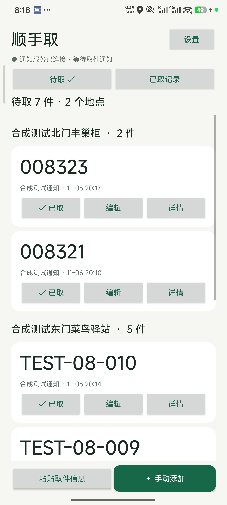
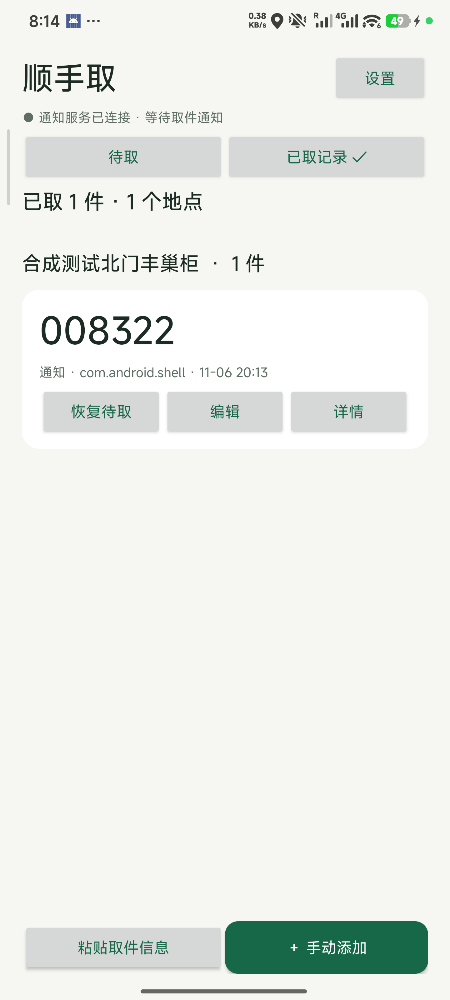

# 顺手取


在本机整理取件信息，出门取件一眼看全。

**[下载 0.3.0 试用版](https://github.com/iyangbo02/shunshouqu/releases/tag/v0.3.0)** · [隐私说明](PRIVACY.md) · [实际测试记录](TEST_REPORT.md)

## 可以做什么

- 自愿开启通知使用权后，从系统提供的可见通知中提取取件码与地点。
- 通知明确待取但没有取件码时，显示“京东有快递待取”等来源提醒，单独统计提醒条数，不把笼统提醒当作确定的包裹件数。
- 按驿站／柜机分组，大字显示取件码，保留前导零和字母。
- 粘贴一条或多条取件文字，核对后保存；也支持手动添加和编辑。
- 标记已取、查看已取记录、恢复误操作、删除单条及确认清空。
- 侧边栏可主动查看作者赞赏码；首次取完或清空时的支持提示只出现一次，卸载或清除应用数据后重置。

## 安装与使用

需要 Android 8.0 或更新系统。从 Releases 下载 `.apk`，在手机文件管理器中打开安装。应用不需要账号，未授权通知使用权时也可手动使用。

开启自动收集：应用设置 → 通知使用权 → 在系统中允许顺手取。首页会区分未授权、等待连接和已连接；连接不等于任意来源通知都能被识别。系统隐藏的内容无法读取，不读取历史短信或聊天数据库。

只能处理系统通知，不能读取购物 App 内部弹窗或直接查询购物账户的订单。仅“物流更新”等模糊内容不会生成待取提醒。同一条单项通知在系统标识与原通知时间都保持一致时，更新提供取件码可补到原提醒，保留已处理状态；身份或时间变化、多项内容不会推测合并，可能需要人工核对。

已有 GitHub 0.2.0 安装包可直接选择更新安装，保留清单；本次继续使用原正式签名。

**此前安装过 debug 测试版的用户：**公开发布包使用正式签名，不能直接覆盖 debug 版。请先妥善保留需要的取件信息，再决定是否更换；不要直接卸载仍有重要数据的测试版。

## 数据与隐私

应用没有联网权限、账号、云同步、广告或统计 SDK。取件记录保存在应用私有数据库，仅在主动粘贴时处理剪贴板。详情保留最多600字核对原文，并按规则遮盖常见手机号和明确验证码；这些规则不保证完全脱敏，记录仍应视为私人数据。

赞赏页面只展示本机图片，不接入支付 SDK，不检测付款或到账。详见 [PRIVACY.md](PRIVACY.md)。

## 验证情况与已知限制

- 0.3.0 核心解析：49 个合成样本通过。
- 0.3.0 本地 Android 测试：16 项 Robolectric 数据库与界面测试通过，含旧数据库迁移、无码提醒、同通知补码、已处理／删除后不复活和来源标题及计数。
- 早期 Redmi K70 Pro / Android 16 实测：11项生产 SQLite 逻辑断言通过；已验证系统合成通知经过监听服务进入数据库和清单，以及导入、编辑、已取与恢复等操作。此历史结果不代替 0.3.0 真机验证。
- 0.3.0 未连接手机，真实京东、淘宝、拼多多通知模板尚未验证。
- 0.2.0 的赞赏相关新交互已构建和静态检查，尚未完成真机验证。
- 红米“强行停止”应用后，重新打开可能仍需关闭再开启通知使用权才能恢复监听。普通返回桌面后的后台接收已验证。
- 真实快递应用模板、多品牌、小屏大字体、设备重启和 Android 8 最低版本行为仍待补测。合成用例不能代表识别准确率或模板覆盖率。

### 真实运行截图

以下截图使用合成取件信息。已取截图来自早期测试阶段，最终版已将来源包名改为可读名称。

 

## 从源码构建

原生 Java + Android 平台界面 + SQLite；无业务第三方 SDK。

- JDK 17
- Android SDK Platform 36、Build Tools 35.0.0
- Android Gradle Plugin 8.13.2、Gradle 8.13（包含 Wrapper）

Windows PowerShell：

```powershell
$env:JAVA_HOME='你的JDK17目录'
$env:ANDROID_HOME='你的Android SDK目录'
./gradlew.bat :app:assembleDebug :app:lintDebug
./scripts/test-logic.ps1
./scripts/test-unit.ps1
```

生成的测试包位于 `app/build/outputs/apk/debug/app-debug.apk`，与公开正式包使用不同签名。

`test-unit.ps1` 使用 PowerShell 7 运行，不需要手机；首次下载的 Robolectric 等依赖仅用于开发测试，不进入主应用。Windows JDK 17 的中文测试类路径会通过当前用户本地应用数据目录中的 ASCII 目录联接处理。

设备数据库测试：

```powershell
./scripts/test-device-store.ps1 -Serial 你的设备序列号
```

测试使用 `/data/local/tmp/ssq-store-tests` 独立目录，不清空正常应用数据库。另有独立的合成通知发送模块和 Android instrumentation 测试，详见测试记录。

正式构建脚本为 `scripts/build-release.ps1`，首次运行会在当前 Windows 用户的本地应用数据目录生成新的本机签名材料；不会获得本项目公开安装包的签名密钥。签名材料及口令没有上传到仓库。

## 反馈

请通过 [Issues](https://github.com/iyangbo02/shunshouqu/issues) 提交问题。通知样本请先去掉真实姓名、手机号、地址、取件码和运单号等私人内容，使用合成内容说明。
